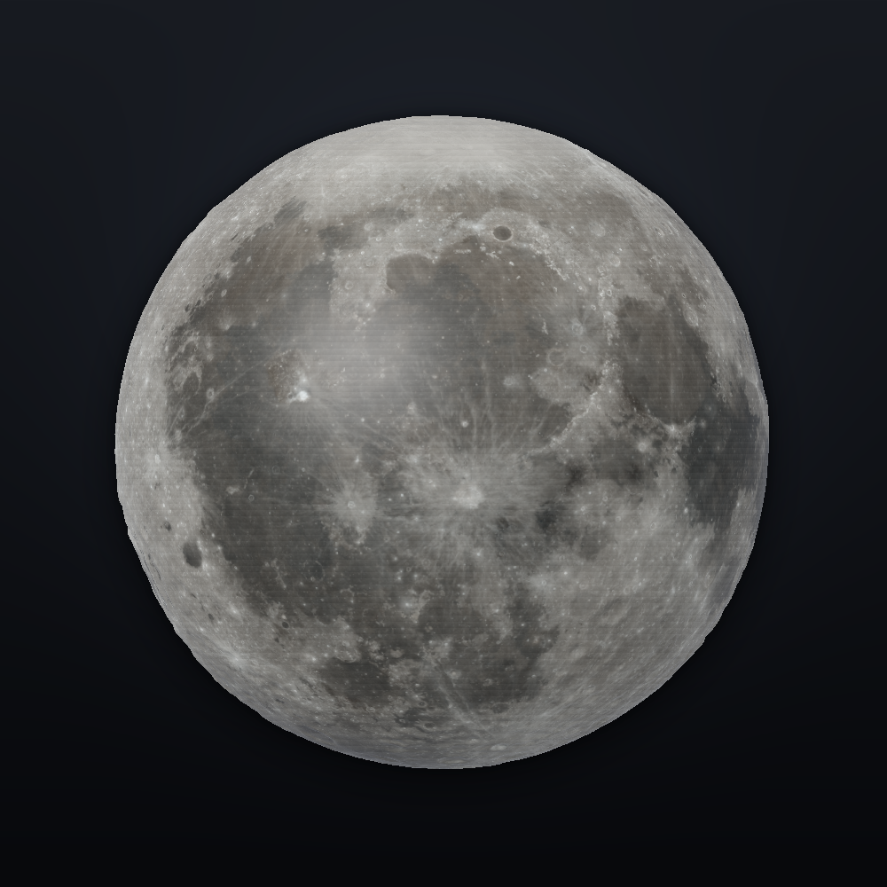
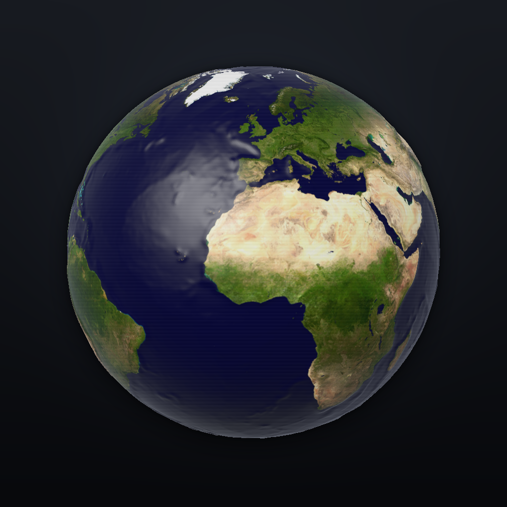
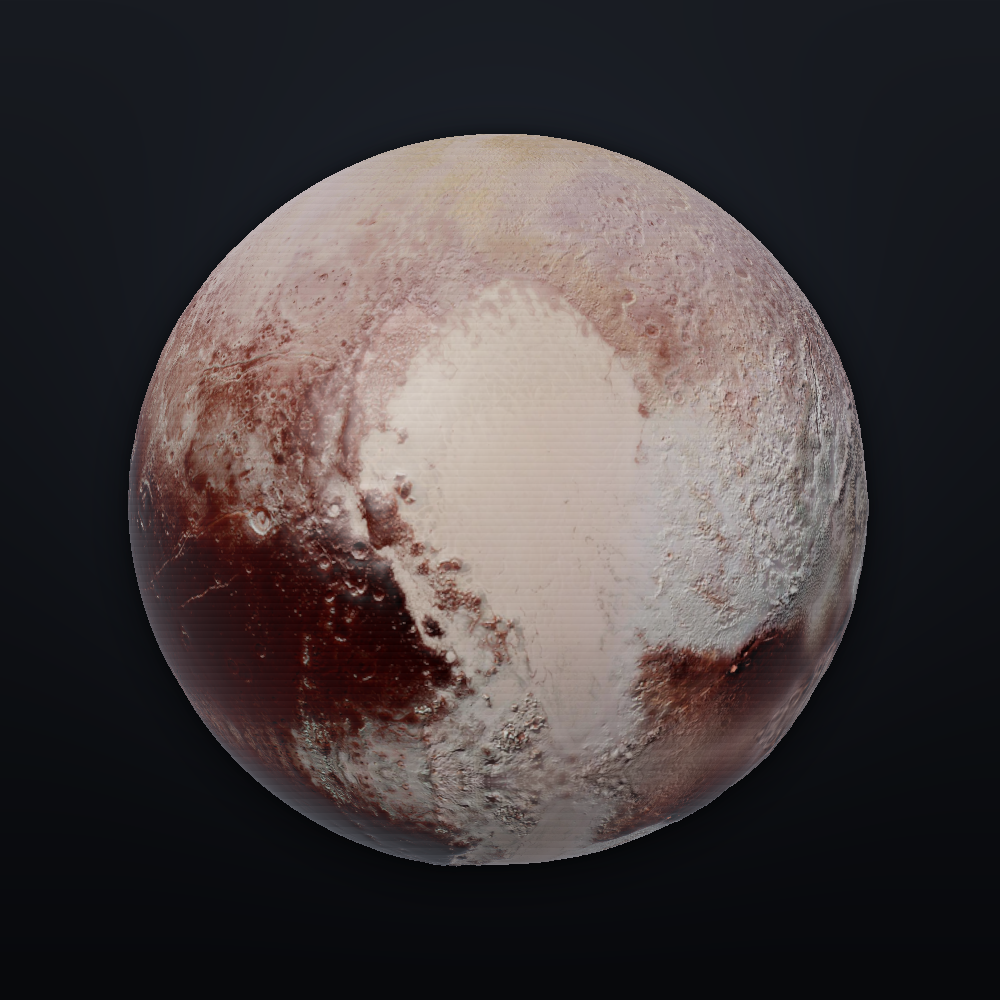
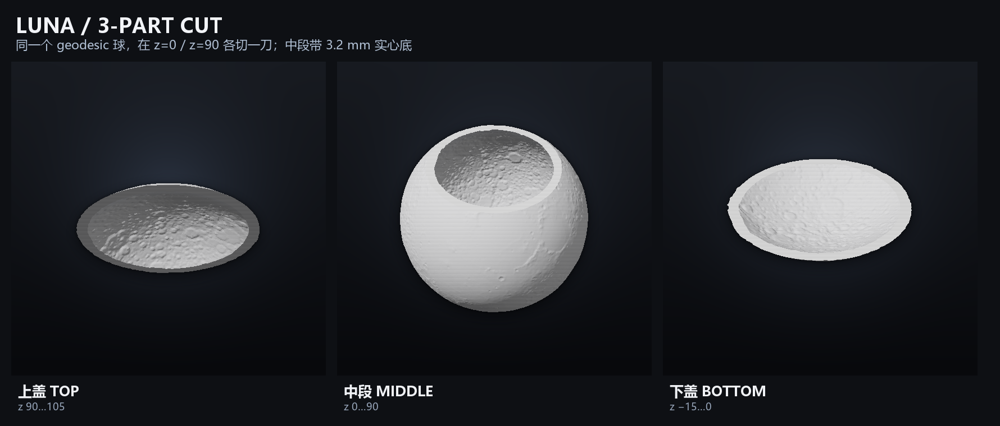

# 单件行星球 · Geodesic Planet Spheres

三个**单件、完整、不能装笔**的行星球：**月球 Luna**、**地球 Terra**、**冥王星 Pluto**。

每个球是 Ø120 mm 的闭合实体，没有杯口、没有补盖、没有装配接缝。表面用真实行星影像 + 真实/派生高程做径向浮雕，网格采用 **geodesic / icosphere**，极区三角面近似均匀，没有经纬网格的极点收敛。每个球**先掏空到 3.2 mm 壁厚，再切成上盖 / 中段 / 下盖**三个闭合壳体，按原坐标可以拼回整球。







## 文件

| 文件 | 说明 |
|---|---|
| [`export/luna_icosphere.stl`](export/luna_icosphere.stl) | 月球单件球，STL，二进制，mm |
| [`export/terra_icosphere.stl`](export/terra_icosphere.stl) | 地球单件球，STL |
| [`export/pluto_icosphere.stl`](export/pluto_icosphere.stl) | 冥王星单件球，STL |
| `export/{planet}_part_{top,middle,bottom}.stl` | 同一球的 **三件套**：z=90 / z=0 各切一刀，三个闭合实体 |
| [`export/*_icosphere.obj`](export/) + `.mtl` + `*_icosphere_texture.png` | 彩色 OBJ/MTL/贴图；STL 本身不带颜色 |
| [`export/SHA256SUMS.txt`](export/SHA256SUMS.txt) | 导出文件 SHA-256 |
| [`preview/icosphere_luna.png`](preview/icosphere_luna.png) · [clay](preview/icosphere_luna_clay.png) | 月球彩色/素模预览 |
| [`preview/icosphere_terra.png`](preview/icosphere_terra.png) · [clay](preview/icosphere_terra_clay.png) | 地球彩色/素模预览 |
| [`preview/icosphere_pluto.png`](preview/icosphere_pluto.png) · [clay](preview/icosphere_pluto_clay.png) | 冥王星彩色/素模预览 |
| [`docs/source_map.png`](docs/source_map.png) | 真实影像 → 高度场 → 浮雕对照 |
| [`docs/vallis_alpes.png`](docs/vallis_alpes.png) | 月球正面阿尔卑斯月谷的真实地形标注 |
| [`data/freecad_validation.json`](data/freecad_validation.json) | FreeCAD Mesh 验证结果 |
| [`data/*_icosphere.npz`](data/) | 网格缓存（顶点/面/UV/法线） |

> 仓库包含 STL/OBJ/原始数据，约 **350 MB**。如果 GitHub 上传较慢，可以只提交源码 + `export/*_part_*.stl` + 预览，把 `assets/raw/`、`data/*.npz`、`export/*.obj` 排除。

## 方法

每张影像都是 2:1 等距圆柱投影。对球面上的每个顶点：

```text
u   = (u_front + (lon − 90°)/360°) mod 1
v   = (90° − lat)/180°
r   = R + height(u,v)·gain
```

- `R = 60 mm`，球心 z=45，范围 z −15…105；
- 先用二十面体细分 7 次生成 **geodesic 球**，再按球面经纬度采样影像/高程；
- 顶点坐标 = 单位球方向 × `r`，因此没有极点扇形收口；
- 浮雕采样后做**球面一环邻域平滑**，方向均匀，不依赖图片坐标的纬度方向；
- 极区没有额外的“极点淡出”补丁，因为网格本身在极点不再收敛；
- 颜色/高程来自真实数据；颜色只存在于 OBJ/贴图，STL 是单色几何。

## 打印

- 这是一个**闭合实体球**，不是空心壳，不能装笔；
- 100% 填充约 **0.95 L / 1.2 kg**；
- 实际打印建议 **5–10% 填充 + 2–3 层壁**，大约 100–150 g；
- 没有开口/排水孔；如果只想做轻量摆件，可在切片里用低填充，不要试图把它改成薄壁空心球。
- **三件套是 3.2 mm 空心壳**，中段带 3.2 mm 实心底，总材料约 156 cm³（PLA ~193 g），3 圈壁、0–10% 填充即可；不需要按实心球去设高填充。

## 三件套切割

每个 geodesic 球在 **z=0** 和 **z=90** 各切一刀，分成三个闭合实体：

| 部件 | z 范围 | 说明 |
|---|---:|---|
| `{planet}_part_top.stl` | 90…105 | 上盖，平面朝下 |
| `{planet}_part_middle.stl` | 0…90 | 中段，上下都是平面 |
| `{planet}_part_bottom.stl` | −15…0 | 下盖，平面朝上 |

- 先把整球做成 **3.2 mm 壁厚** 的空心壳，再切；
- 三件都保留原装配坐标；按原位叠起来就是完整空心球，接缝是两条 **z=constant** 的平面切口；
- **中段底部加了一层 3.2 mm 实心底**（z 0…3.2），所以中段本身是一个可以装笔的杯子：上端 z=90 开口，内深约 86.8 mm；
- 上盖/下盖仍是空心壳；中段底部外表面是实心底盘，不再是通孔；
- 每个部件仍是闭合 `solid`；
- 打印时把各自的平面切面贴床：上盖/下盖翻到平面朝下，中段把 z=0 的底面朝下平放；
- 三件总材料约 **156 cm³**（PLA 约 193 g），比实心球的 1.2 kg 轻很多；3 圈壁、0–10% 填充即可。



## 查看

用任意 STL 查看器（Blender、Windows 3D 查看器、Cura 预览等）打开 `export/` 下的文件。三件套保留原装配坐标，直接按原坐标叠放即可看到整球；本仓库不包含本地 `stl-review` 服务。

## 验证

FreeCAD 1.1.4 Mesh 工作台：

| 文件 | 三角面 | 顶点 | 实体 | 非流形边 | 自交 | 组件数 | 体积 |
|---|---:|---:|---|---:|---|---:|---:|
| `luna_icosphere.stl` | 327,680 | 163,842 | ✅ | 0 | 无 | 1 | 946,728.31 mm³ |
| `terra_icosphere.stl` | 327,680 | 163,842 | ✅ | 0 | 无 | 1 | 941,691.19 mm³ |
| `pluto_icosphere.stl` | 327,680 | 163,842 | ✅ | 0 | 无 | 1 | 946,491.31 mm³ |
| `luna_part_top.stl` | 82,958 | 41,481 | ✅ | 0 | 切面微共面* | 1 | 16,984.86 mm³ |
| `luna_part_middle.stl` | 495,756 | 247,880 | ✅ | 0 | 切面微共面* | 1 | 122,001.00 mm³ |
| `luna_part_bottom.stl` | 82,730 | 41,367 | ✅ | 0 | 切面微共面* | 1 | 16,890.84 mm³ |
| `terra_part_top.stl` | 83,336 | 41,670 | ✅ | 0 | 切面微共面* | 1 | 17,160.06 mm³ |
| `terra_part_middle.stl` | 495,912 | 247,958 | ✅ | 0 | 切面微共面* | 1 | 121,289.50 mm³ |
| `terra_part_bottom.stl` | 82,182 | 41,093 | ✅ | 0 | 切面微共面* | 1 | 16,809.79 mm³ |
| `pluto_part_top.stl` | 81,828 | 40,916 | ✅ | 0 | 切面微共面* | 1 | 16,591.24 mm³ |
| `pluto_part_middle.stl` | 495,300 | 247,652 | ✅ | 0 | 切面微共面* | 1 | 122,420.48 mm³ |
| `pluto_part_bottom.stl` | 84,242 | 42,123 | ✅ | 0 | 切面微共面* | 1 | 17,267.45 mm³ |

十二个模型均为 `is_solid = true`、0 非流形边、1 组件。

`*` 空心切块的环形切面上有少量 **亚 0.01 mm 的共面三角形自交**，FreeCAD 会标记；它是切面网格的退化三角形，实体仍水密、0 非流形，切片不受影响。

## 复现

```bat
cd 3d-moon
python -m pip install -r requirements.txt

rem 影像/高程 -> 2:1 贴图 + 毫米高度场
python scripts\prepare_assets.py

rem 只生成 3 个 geodesic 单件球
python scripts\planet_cup.py

rem 在 z=0 / z=90 切成 9 个闭合部件
python scripts\split_sphere.py

rem 彩色/素模预览 + 三件套拼图
python scripts\render_preview.py
python scripts\render_parts.py

rem FreeCAD 验证
FreeCADCmd scripts\validate_freecad.py
```

## 数据来源与限制

- 月球：NASA SVS CGI Moon Kit，LROC WAC 彩色 + LOLA 4 ppd 高程；NASA/GSFC/ASU/LROC/LOLA。
- 地球：NASA Blue Marble 2002 + NOAA ETOPO1；NASA Earth Observatory / NOAA NCEI。
- 冥王星：Solar System Scope 纹理（CC-BY 4.0）+ New Horizons 影像；−25° 以南没有真实覆盖，用同源影像**镜像**补全，不是实际观测。
- 浮雕是设计化夸张，不是测绘模型；地球高程被压缩到约 1.3 mm，月球/冥王星用于可触摸效果。
- 单件球是实体网格；OBJ 的经线处有 UV 接缝，STL 没有几何接缝。
- 三件套是 **3.2 mm 空心壳**；中段带 3.2 mm 实心底，可以装笔。切面边缘轮廓会随浮雕轻微起伏。`*_part_*.stl` 只有 STL，没有彩色 OBJ；颜色参考用整球 OBJ/预览。
- 整球 `*_icosphere.stl` 保留作对照/彩色参考；如果只需要打印三件套，直接用 `*_part_*.stl`。
- 详细署名见 [`NOTICE.md`](NOTICE.md)。
